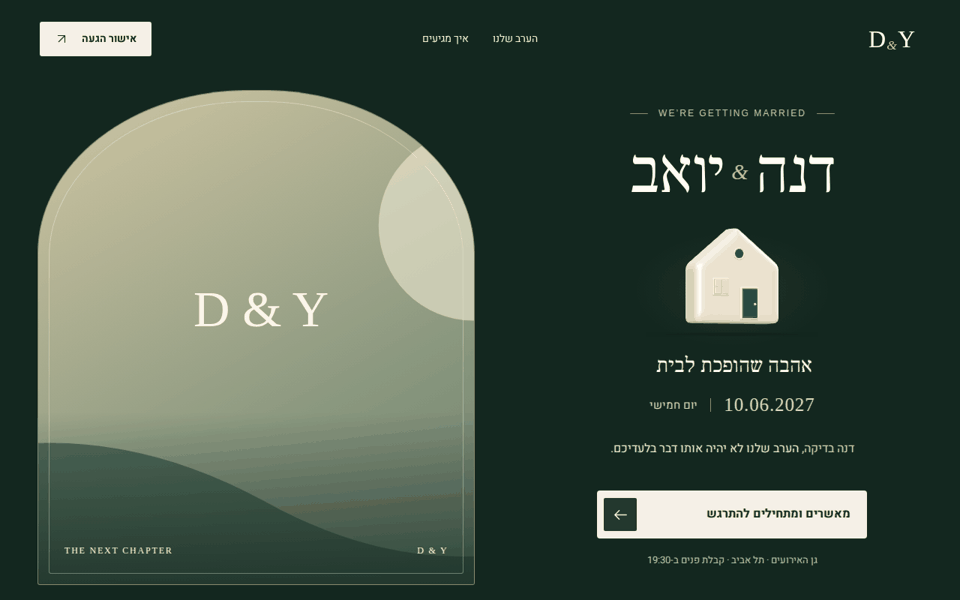
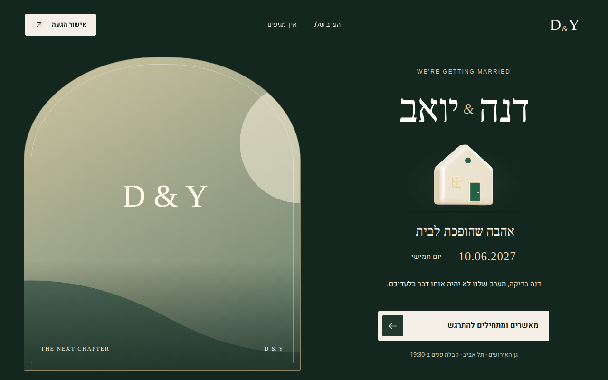
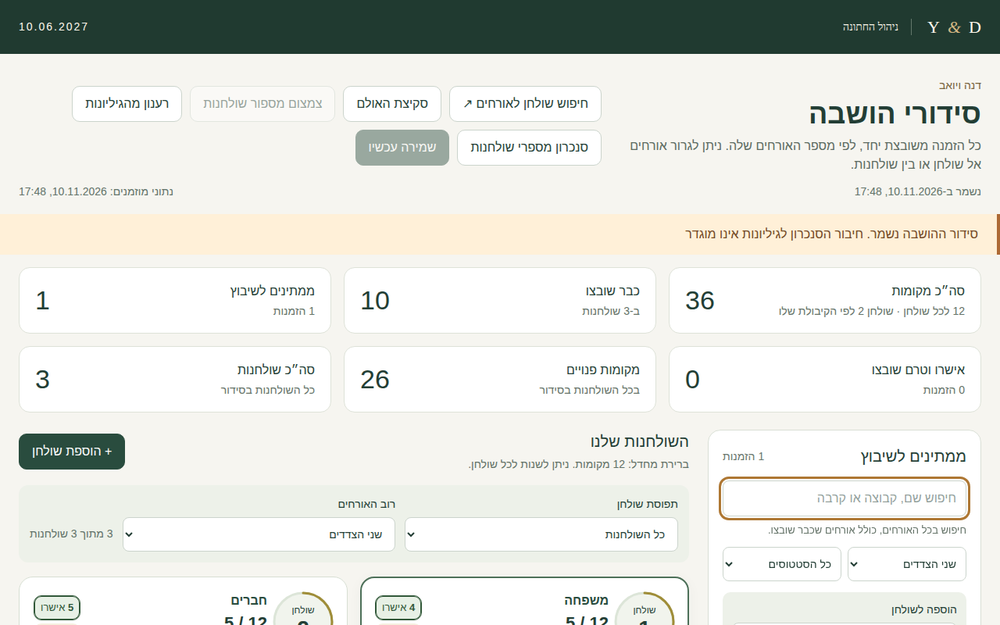
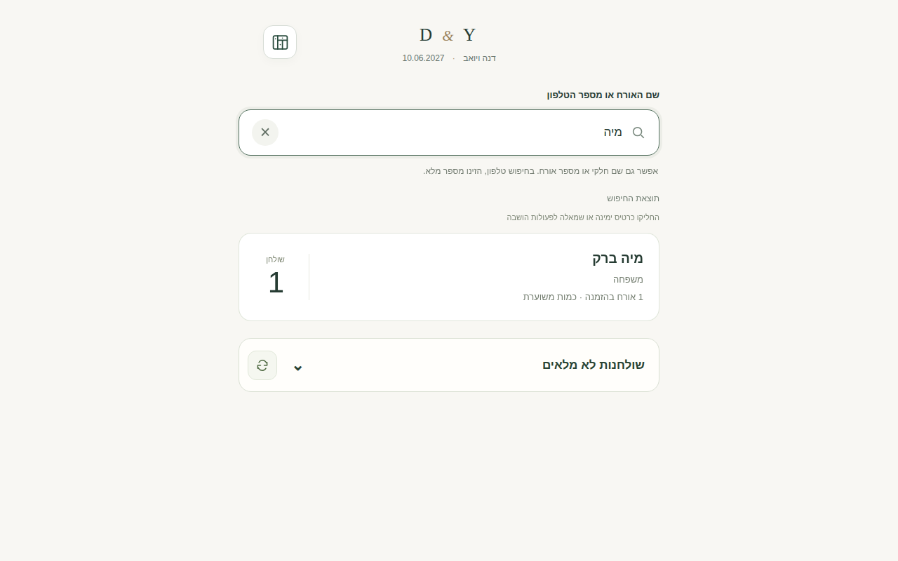
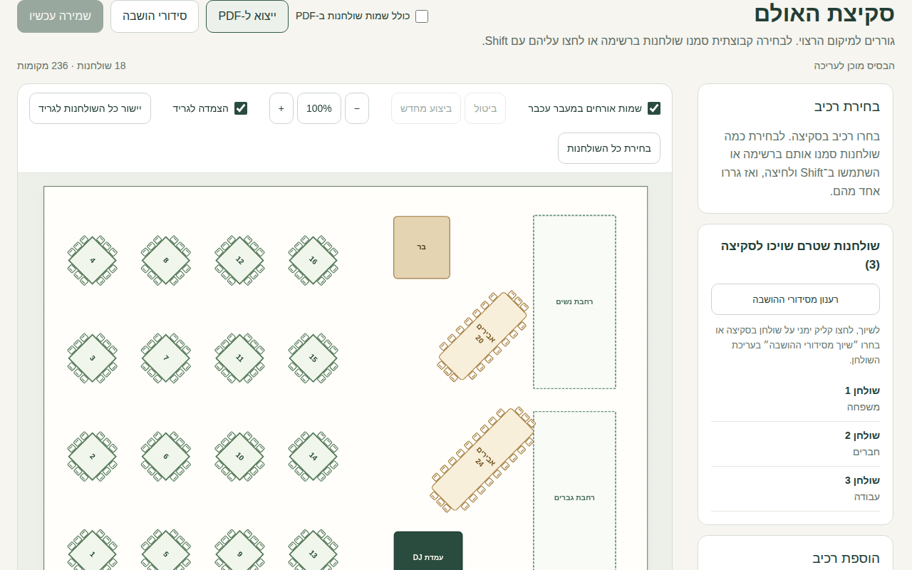
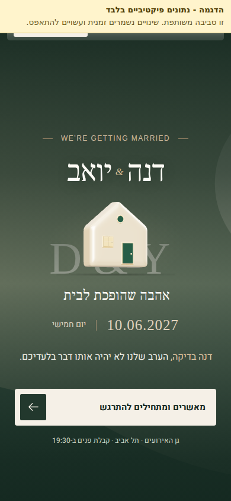
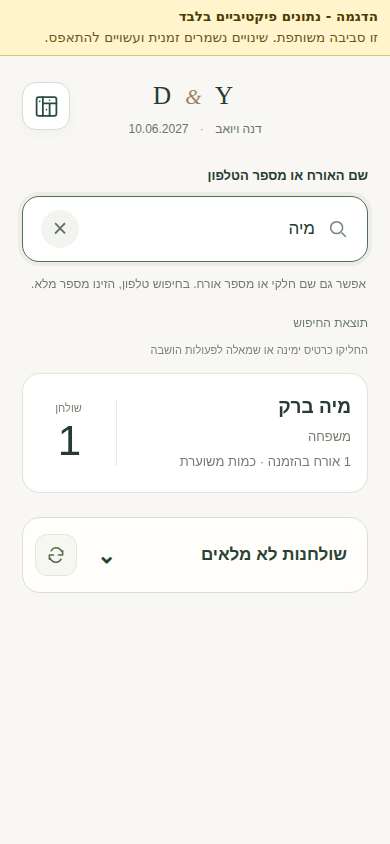
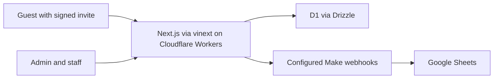

# Wedding RSVP and seating

A Hebrew, right-to-left wedding invitation, RSVP system, guest calling workflow, seating planner, room sketch and staff table finder. This is a separate public edition of a Sites project with **fictional example data**. It does not contain the original guest list, photographs, credentials or database.

Built with AI-assisted development and automated tests. This is a self-hosted example, not a hosted service or a turnkey production deployment.

## Features

- Signed personal invitation links, attendance and guest counts, and an outbound RSVP sync with a pending record on failure.
- Admin pages for calls, invitations, reconciliation, table assignment and a draggable sketch with PDF export.
- Staff table finder with Hebrew fuzzy matching, phone and guest-number lookup, unseated matches first, signed seating tickets, capacity/revision validation and undo.
- Optional Google Sheets sync through external webhook endpoints. Column T is the numeric table number.
- Six fictional guests and three tables in local demo mode.

## Demo tour

This tour uses fictional demo records. Desktop and mobile screenshots are generated by the automated demo flows.



| Invitation | Seating planner |
| --- | --- |
|  |  |
| Hebrew table search | Room sketch and PDF export |
|  |  |

| Mobile invitation and RSVP | Mobile Hebrew table search |
| --- | --- |
|  |  |


## Live demo

**[Open the fictional live demo](https://wedding-rsvp-seating-demo.inonalfa.workers.dev)**

The hosted demo contains fictional data only and displays a banner on every page. On the homepage, use **Try the demo** to open a runtime-signed fictional invitation and submit the RSVP form end to end. The same box links to the Hebrew table search when it is public; otherwise it explains that staff authentication is required. Admin pages are password-protected with username `admin`; the password is available on request. Integrations are disabled in the demo. Submitted names and notes are discarded in favor of the signed fictional identity, and repeated submissions update the same demo response, so the shared flow remains ready for the next visitor.

## Hosted pilot

The repository also contains a separate, open-source hosted edition for couples to sign in, create an event, import guests, share invitations and arrange seating without installing anything. The hosted edition is designed to be free with explicit limits and no SLA. It is not deployed by this repository. See the [hosted plan](docs/hosted-service-plan.md) and [operator deployment guide](docs/hosted-deploy.md). The existing fictional demo and self-hosted setup below are unchanged.

## Architecture



The Worker verifies invitation and seating tokens, checks admin or staff credentials and stores RSVP and seating revisions in D1. Optional webhook calls exchange updates with external Make scenarios. Those scenarios must be implemented and secured separately.

### Why this stack

Next.js keeps the interface and route handlers together. vinext builds them for Cloudflare Workers, while D1 supplies a SQLite-compatible store without a separate database server. Drizzle handles typed RSVP queries; prepared statements handle revision-sensitive seating updates. The tradeoff is a dependency on Cloudflare and vinext's compatibility layer.

## Local setup

Use Node.js 22.13+, npm and Linux with `flock`, `curl` and GNU `timeout` for the included build helpers. A Cloudflare account is needed only for deployment.

```sh
npm ci
npm run demo:setup
npx wrangler d1 migrations apply site-creator-d1 --local
npm run dev
```

Open the URL printed by Vite. The demo setup creates ephemeral credentials in ignored `.dev.vars`; use username `admin` and the generated `ADMIN_PASSWORD` for `/admin`, or `STAFF_PASSWORD` for `/find-table`. Fictional guests and seating are seeded on first access. Use an isolated D1 database. Run `npm run typecheck`, `npm run lint`, `npm test` and `npm run test:e2e` for verification. The setup command refuses to overwrite an existing `.dev.vars`.

Before the first browser test, run `npx playwright install chromium`. CI installs its own browser and uses a fresh D1 database. Browser tests change only the fictional demo records. If you already have Chromium locally, set `PLAYWRIGHT_CHROMIUM_EXECUTABLE_PATH` to its executable path.

## Configure your event

Edit the typed fictional example in `config/event.ts` for hosts, monogram, date and time, venue, contact, sheet names, invite ID prefixes and seating policy. `lib/event-config.ts` derives display dates and map links from it. The default reserved table is 2, with overflow allowed; change `seating.reservedTableNumber` and `allowReservedTableOverflow` for your event. Replace the fictional SVG artwork under `public/` if the demo design does not fit. The sample read source has two tabs of rows A:T. Review `lib/seating-model.ts` and `lib/demo-data.ts` before connecting real data. Changing an event's invite ID prefixes after links have been issued invalidates those links.

For your own event, copy `.dev.vars.example` into `.dev.vars` in a separate checkout and fill every needed value. Both environment examples list every scalar Worker setting with a comment; `.dev.vars` is the file Wrangler uses locally. Blank secrets are placeholders: generate and fill them before using the affected feature. Missing admin/staff passwords fail closed. Apply migrations before starting the Worker. Set deployed secrets with Wrangler or your deployment secret manager. Never commit `.dev.vars`, a database, a real guest export or invitation links.

| Variable | Purpose |
| --- | --- |
| `DEMO_MODE` | `1` loads fictional guests and disables outbound seating sync; `0` for real data. |
| `DEMO_AUTH` | `1` keeps Basic authentication on for the fictional demo. `demo:setup` enables it. |
| `ADMIN_PASSWORD`, `STAFF_PASSWORD` | Independent long secrets for standalone HTTP Basic auth. The username is `admin`; use HTTPS. |
| `ADMIN_EMAILS` | First email is the authenticated admin identity; required for admin authorization in production. |
| `INVITE_TOKEN_SECRET`, `INVITE_SHORT_TOKEN_SECRET` | Independent 32-byte Base64URL secrets for invitation links and seating tickets. |
| `INVITE_TOKEN_TTL_SECONDS` | New v3 invite lifetime, default 7776000 seconds (90 days), maximum 31536000. |
| `LEGACY_INVITE_TTL_SECONDS` | Lifetime of v1/v2 and AES-GCM links, measured from the first successful open. Default 7776000. `0` keeps those links from auto-expiring. |
| `INVITE_TOKENS_EXPIRE_AT` | Optional ISO UTC deadline that closes all invitation formats; set it for your event. |
| `REQUIRE_INVITE_TOKEN` | Default on for a real event: RSVP requires a signed invite. `0` allows the open form. The demo still requires a fictional invite. |
| `SEATING_TOKEN_EPOCH` | Change this value to revoke outstanding seating cards. |
| `SEATING_SHEETS_WEBHOOK_URL` | POST endpoint returning `{ "valueRanges": [{ "range": "'מוזמנים דנה'!A1:T4", "values": [...] }, ...] }`. |
| `MAKE_WEBHOOK_URL` | POST endpoint receiving RSVP, opening and seating updates. |
| `SEATING_SYNC_SECRET`, `WHATSAPP_RSVP_SECRET` | Bearer secrets for service endpoints. Each is also the HMAC key for that endpoint. |
| `WEBHOOK_HMAC_REQUIRED` | `1` requires `X-Webhook-Signature` on inbound service calls. Unset keeps missing signatures working. |
| `MAKE_WEBHOOK_HMAC_SECRET` | When set, outbound Make posts include a body signature. |
| `SITES_DISPATCH_SECRET` | Shared secret the Sites dispatch layer must send as `X-Sites-Dispatch`. Required before `AUTH_MODE=sites` will serve admin routes on a real event (`DEMO_MODE=0`). |
| `GUEST_DATA_RETENTION_AT` | ISO UTC instant after which the daily cron deletes guest data. Leave empty until you choose a date. |
| `AUTH_MODE` | Defaults to standalone Basic auth. `sites` trusts identity injected by the Sites dispatch layer. On `DEMO_MODE=0` that mode is refused unless `SITES_DISPATCH_SECRET` matches. |

Generate each secret independently. Invitation signing/encryption secrets must be 32 random bytes encoded as Base64URL, for example `node -e "console.log(require('node:crypto').randomBytes(32).toString('base64url'))"`. Do not reuse demo credentials for your event.

`DB` is the D1 binding declared in `wrangler.jsonc`. `ASSETS` (adapter-managed static assets) and `IMAGES` (optional image optimization) are Worker bindings, not scalar variables in `.dev.vars`. Keep deployment secrets outside committed Wrangler configuration.

### RSVP guest limits

A personal invitation with a positive `maxGuests` enforces that limit in both the server and form, including WhatsApp updates. The existing value `0` means unspecified (newly generated open-count invitations), so it retains the general safety limit of 1000. Declines store zero attendees.

### Sheets contract

The read webhook returns `valueRanges` for tabs matching `eventConfig.sheetNames`, each with a header and rows A:T. Relevant columns: D phone, E invited count, G guest number, I stable invite ID, J RSVP status, K confirmed count, T table number. `MAKE_WEBHOOK_URL` receives JSON events with `schemaVersion` and `event`. For `seating.updated`, locate the row by `inviteId` and `sourceSheet`, write integer `tableNumber` to T or clear it when the value is `""`, and respond `{ "ok": true, "event": "seating.updated" }` only after a successful write. The application leases synchronization, tracks a snapshot and retries pending changes. Implement and secure the external scenario separately. Inbound service calls require bearer auth plus fresh timestamp and nonce headers. Set `WEBHOOK_HMAC_REQUIRED=1` after callers send `X-Webhook-Signature`, as described in [the webhook protocol](docs/WEBHOOK_PROTOCOL.md). Browser admin sync continues to use Basic auth.

## Deploy your own

The repository does not deploy from GitHub Actions. Connect your own Cloudflare Workers project or deploy from your machine after configuring a separate D1 database and secrets. Keep `wrangler.jsonc` strict JSON because Cloudflare Workers Builds parses it directly. Demo mode seeds fictional records on first use; use `DEMO_MODE=0` for a real event.

To reproduce the mobile screenshots, start the fictional demo on port 4173, install Chromium once with `npx playwright install chromium`, then run `npm run screenshots:mobile`. The script reads the generated demo credentials and writes both PNG files under `docs/media/`.

## Deploy on Cloudflare

1. Authenticate your own Cloudflare account with `npx wrangler login`. Create a separate D1 database: `npx wrangler d1 create wedding-rsvp-seating`. Put its ID and name in `wrangler.jsonc`; Vite uses that same configuration.
2. Set deployed secrets with `npx wrangler secret put NAME`, including independent signing and Basic auth secrets. Use two different passwords of at least 12 characters. Configure `ADMIN_EMAILS`, `AUTH_MODE=basic`, `DEMO_MODE=0`, HTTPS and integration endpoints in your Worker environment. Set `GUEST_DATA_RETENTION_AT` when you know the deletion date, and `WEBHOOK_HMAC_REQUIRED=1` after Make sends signatures. A public demo requires its own D1 database and separate write protection or reset policy.
3. Apply migrations with `npx wrangler d1 migrations apply wedding-rsvp-seating --remote`.
4. Run `npm run typecheck && npm run lint && npm test`, then `npx vinext deploy`. Verify the assigned Worker URL, protected routes and a test RSVP before distributing links.

The checked-in migrations retain the original schema history. `.openai/hosting.json` exists for optional Sites packaging with a placeholder project ID; ordinary Cloudflare deployment uses `wrangler.jsonc`.

## Security and privacy

The Worker uses request-local D1 bindings and configuration so concurrent requests do not mix secrets. Standalone mode strips client-supplied identity headers and protects admin and table-finder routes with HTTPS, separate passwords and a short lockout. Demo mode contains only fictional records. Staff search returns names, tables and signed seating tickets, so restrict staff credentials. Real RSVPs require a personal invite unless `REQUIRE_INVITE_TOKEN=0`. D1 rate limiting protects public RSVP and invitation endpoints; add edge controls and monitoring for a real deployment. Set `GUEST_DATA_RETENTION_AT` and follow the [guest-data deletion procedure](docs/DATA_RETENTION.md), rotate credentials after the event and use separate staging and production databases. HTTP Basic credentials may remain cached in a browser session.

See [SECURITY.md](SECURITY.md), [release verification](docs/RELEASE_VERIFICATION.md) and [CONTRIBUTING.md](CONTRIBUTING.md). MIT licensed; font files in `public/fonts/` retain their SIL OFL notices.

## Known limitations

A real event rejects RSVPs that do not carry a signed invite. Legacy links expire after their first open unless you disable that timer, and one invite can be revoked in the admin UI. Details are in [token lifecycle](docs/TOKEN_LIFECYCLE.md). External Make/Sheets scenarios are not bundled; turn on body signatures when those callers are ready. Basic authentication now requires HTTPS and a lockout, and it is still weaker than a dedicated identity provider. See [SECURITY.md](SECURITY.md) for the remaining limitations. The live demo is shared and may be reset; it is not a persistent event workspace.

## Roadmap

- Migration of remaining legacy invitation links onto v3 before their stored expiry.
- A dedicated identity provider in place of HTTP Basic for standalone admin.
- Edge abuse monitoring in front of the D1 rate limits.
- Further separation of the larger admin planners as their workflows evolve.
