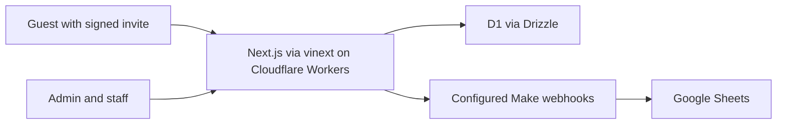

# Wedding RSVP and seating

A Hebrew, right-to-left wedding invitation, RSVP system, guest calling workflow, seating planner, room sketch and staff table finder. This is a separate public edition of a Sites project with **fictional example data**. It does not contain the original guest list, photographs, credentials or database.

Built with AI-assisted development and automated tests. This is a self-hosted example, not a hosted service or a turnkey production deployment.

## Features

- Signed personal invitation links, attendance and guest counts, and an outbound RSVP sync with a pending record on failure.
- Admin pages for calls, invitations, reconciliation, table assignment and a draggable sketch with PDF export.
- Staff table finder with Hebrew fuzzy matching, phone and guest-number lookup, unseated matches first, signed seating tickets, capacity/revision validation and undo.
- Optional Google Sheets sync through external webhook endpoints. Column T is the numeric table number.
- Six fictional guests and three tables in local demo mode.

## Architecture



The Worker verifies invitation and seating tokens, checks admin or staff credentials and stores RSVP and seating revisions in D1. Optional webhook calls exchange updates with external Make scenarios. Those scenarios must be implemented and secured separately.

### Why this stack

Next.js keeps the interface and route handlers together. vinext builds them for Cloudflare Workers, while D1 supplies a SQLite-compatible store without a separate database server. Drizzle handles typed RSVP queries; prepared statements handle revision-sensitive seating updates. The tradeoff is a dependency on Cloudflare and vinext's compatibility layer.

## Local setup

Use Node.js 22.13+, npm and Linux with `flock`, `curl` and GNU `timeout` for the included build helpers. A Cloudflare account is needed only for deployment.

```sh
npm ci
npm run demo:setup
npx wrangler d1 migrations apply site-creator-d1 --local
npm run dev
```

Open the URL printed by Vite. The demo setup creates ephemeral credentials in ignored `.dev.vars`; use username `admin` and the generated `ADMIN_PASSWORD` for `/admin`, or `STAFF_PASSWORD` for `/find-table`. Fictional guests and seating are seeded on first access. Use an isolated D1 database. Run `npm run typecheck`, `npm run lint`, `npm test` and `npm run test:e2e` for verification. The setup command refuses to overwrite an existing `.dev.vars`.

Before the first browser test, run `npx playwright install chromium`. CI installs its own browser and uses a fresh D1 database. Browser tests change only the fictional demo records. If you already have Chromium locally, set `PLAYWRIGHT_CHROMIUM_EXECUTABLE_PATH` to its executable path.

## Configure your event

Edit the typed fictional example in `config/event.ts` for hosts, monogram, date and time, venue, contact, sheet names, invite ID prefixes and seating policy. `lib/event-config.ts` derives display dates and map links from it. The default reserved table is 2, with overflow allowed; change `seating.reservedTableNumber` and `allowReservedTableOverflow` for your event. Replace the fictional SVG artwork under `public/` if the demo design does not fit. The sample read source has two tabs of rows A:T. Review `lib/seating-model.ts` and `lib/demo-data.ts` before connecting real data. Changing an event's invite ID prefixes after links have been issued invalidates those links.

For your own event, copy `.dev.vars.example` into `.dev.vars` in a separate checkout and fill every needed value. Set deployed secrets with Wrangler or your deployment secret manager. Never commit `.dev.vars`, a database, a real guest export or invitation links.

| Variable | Purpose |
| --- | --- |
| `DEMO_MODE` | `1` loads fictional guests and disables outbound seating sync; `0` for real data. |
| `DEMO_AUTH` | `1` keeps Basic authentication on for the fictional demo. `demo:setup` enables it. |
| `ADMIN_PASSWORD`, `STAFF_PASSWORD` | Independent long secrets for standalone HTTP Basic auth. The username is `admin`; use HTTPS. |
| `ADMIN_EMAILS` | First email is the authenticated admin identity; required for admin authorization in production. |
| `INVITE_TOKEN_SECRET`, `INVITE_SHORT_TOKEN_SECRET` | Independent secrets for invitation links and seating tickets. |
| `SEATING_SHEETS_WEBHOOK_URL` | POST endpoint returning `{ "valueRanges": [{ "range": "'מוזמנים דנה'!A1:T4", "values": [...] }, ...] }`. |
| `MAKE_WEBHOOK_URL` | POST endpoint receiving RSVP, opening and seating updates. |
| `SEATING_SYNC_SECRET`, `WHATSAPP_RSVP_SECRET` | Bearer secrets for service endpoints. |
| `AUTH_MODE` | Defaults to standalone Basic auth. `sites` trusts identity injected by the Sites dispatch layer. Never use `sites` on a directly exposed Worker. |

Generate each secret independently. Invitation signing/encryption secrets must be 32 random bytes encoded as Base64URL, for example `node -e "console.log(require('node:crypto').randomBytes(32).toString('base64url'))"`. Do not reuse demo credentials for your event.

### Sheets contract

The read webhook returns `valueRanges` for tabs matching `eventConfig.sheetNames`, each with a header and rows A:T. Relevant columns: D phone, E invited count, G guest number, I stable invite ID, J RSVP status, K confirmed count, T table number. `MAKE_WEBHOOK_URL` receives JSON events with `schemaVersion` and `event`. For `seating.updated`, locate the row by `inviteId` and `sourceSheet`, write integer `tableNumber` to T or clear it when the value is `""`, and respond `{ "ok": true, "event": "seating.updated" }` only after a successful write. The application leases synchronization, tracks a snapshot and retries pending changes. Implement and secure the external scenario separately.

## Deploy on Cloudflare

1. Authenticate your own Cloudflare account with `npx wrangler login`. Create a separate D1 database: `npx wrangler d1 create wedding-rsvp-seating`. Put its ID and name in `wrangler.jsonc` and the D1 entry in `vite.config.ts`.
2. Set deployed secrets with `npx wrangler secret put NAME`, including independent signing and Basic auth secrets. Configure `ADMIN_EMAILS`, `AUTH_MODE=basic`, `DEMO_MODE=0`, HTTPS and integration endpoints in your Worker environment. A public demo requires its own D1 database and separate write protection or reset policy.
3. Apply migrations with `npx wrangler d1 migrations apply wedding-rsvp-seating --remote`.
4. Run `npm run typecheck && npm run lint && npm test`, then `npx vinext deploy`. Verify the assigned Worker URL, protected routes and a test RSVP before distributing links.

The checked-in migrations retain the original schema history. `.openai/hosting.json` exists for optional Sites packaging with a placeholder project ID; ordinary Cloudflare deployment uses `wrangler.jsonc`.

## Security and privacy

The Worker uses request-local D1 bindings and configuration so concurrent requests do not mix secrets. Standalone mode strips client-supplied identity headers and protects admin and table-finder routes. Demo mode contains only fictional records. Staff search returns names, tables and signed seating tickets, so restrict staff credentials. D1 rate limiting protects public RSVP and invitation endpoints; add edge controls and monitoring for a real deployment. Set a retention policy for personal information, rotate credentials after the event and use separate staging and production databases. HTTP Basic credentials may remain cached in a browser session.

See [SECURITY.md](SECURITY.md) and [CONTRIBUTING.md](CONTRIBUTING.md). MIT licensed; font files in `public/fonts/` retain their SIL OFL notices.

## Known limitations

The general RSVP form accepts submissions without an invitation link. Existing invitation tokens have no expiry or individual revocation, and external Make/Sheets scenarios are not bundled. HTTP Basic authentication and D1 rate limits need additional operational controls for a real event. See [SECURITY.md](SECURITY.md) for the complete limitations. No public live demo is currently deployed.

## Roadmap

- Expiring invitation tokens, individual revocation and a compatibility migration.
- Stronger admin identity, a read-only or periodically reset hosted demo.
- Signed integration payloads, retention jobs and edge abuse monitoring.
- Further separation of the larger admin planners as their workflows evolve.
